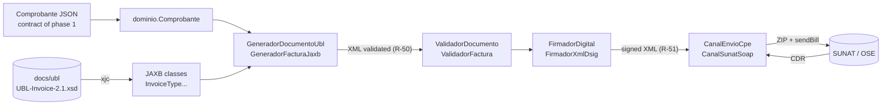

# Phase 2 – Implementation: UBL 2.1 invoice XML generation, validation and submission

Second midterm (Software Architecture, UNAS). It implements the ports specified in phase 1
(`specs/04-api/puertos-salida.md`) following **ADR-006**: the invoice XML is produced from Java classes
**generated from the official `UBL-Invoice-2.1.xsd`**, never written by hand.

| Requirement | Where |
|---|---|
| XML generation from the Invoice XSD 2.1 (classes + "XSD migrator") | Gradle task `generateUblClasses` runs **xjc** (JAXB 4) on `docs/ubl/maindoc/UBL-Invoice-2.1.xsd` → ~1,240 Java classes in `build/generated/xjc`. [`GeneradorFacturaJaxb`](src/main/kotlin/pe/abc/facturacion/adaptadores/ubl/GeneradorFacturaJaxb.kt) maps the domain `Comprobante` to `InvoiceType` and marshals it **validating against the XSD** (R-50) |
| Language of the domain | **Kotlin** on the JVM (ADR-002), Gradle, JDK 17+ |
| Validation of the XML | [`ValidadorFactura`](src/main/kotlin/pe/abc/facturacion/adaptadores/validacion/ValidadorFactura.kt): official XSD + SUNAT rules R-01…R-36 on the XML, reading the catalogs and the ICBPER schedule from `docs/sunat/` |
| Submission of the XML | [`FirmadorXmlDsig`](src/main/kotlin/pe/abc/facturacion/adaptadores/firma/FirmadorXmlDsig.kt) (XMLDSig enveloped in `ext:UBLExtensions`, R-51) and [`CanalSunatSoap`](src/main/kotlin/pe/abc/facturacion/adaptadores/envio/CanalSunatSoap.kt) (`sendBill`, ZIP `RUC-TYPE-SERIES-NUMBER.zip`, CDR classified by return-code range R-54/R-55) |
| Unit tests of generation | [`src/test/kotlin`](src/test/kotlin/pe/abc/facturacion) – **44 JUnit 5 tests** |

## Architecture (hexagonal, ADR-001)

The domain (`dominio`) knows nothing about JAXB or XML; ports are in `puertos`; each adapter implements one port.

## How to run (Windows, Linux, macOS)
Requires **JDK 17 or later** (`java -version`). Gradle is downloaded by the wrapper. Run inside `implementacion/`:
```bash
./gradlew test          # Windows: gradlew.bat test   → generates the classes from the XSD, compiles and runs the 44 tests
./gradlew generateUblClasses                          # only the "XSD migrator" (see build/generated/xjc)
./gradlew generar --args="../specs/02-dominio/ejemplos/comprobante.factura.json build/F001-1.xml"
./gradlew generar --args="../specs/02-dominio/ejemplos/comprobante.factura.json build/F001-1.xml src/test/resources/cert-prueba.p12 prueba"   # also signs
```
The test report is in `build/reports/tests/test/index.html`.

## The tests
The examples of phase 1 (`specs/02-dominio/ejemplos/`), already validated by `tools/verificar.py`, are the **test oracle**
(ADR-006, golden tests): the generated XML must be equivalent (XMLUnit, ignoring whitespace and comments) to the expected XML.

| Class | What it proves |
|---|---|
| `GeneradorFacturaTest` (13) | Invoice F001-1, invoice with ISC on credit F001-2 and receipt B001-1 are **equivalent to the expected XML** and pass XSD + rules; header, `InvoiceTypeCode/@listID`, legend 1000; ISC system 02 with `Percent` 37.50 and without `PerUnitAmount` (D-11); ICBPER with `BaseUnitMeasure` + `PerUnitAmount` (item 37-A); credit with instalments (RS 193-2020); receipt with DNI and exempt line; a document without lines is rejected by the XSD before signing (R-50) |
| `ValidadorFacturaTest` (19) | The valid invoice has no findings and **each injected error is caught with its rule**: R-50, R-02, R-10, R-11, R-20, R-22, R-24, R-26, R-28, R-31, R-34, R-35, R-36 |
| `FirmadorXmlDsigTest` (5) | The signature verifies with the certificate, is the first child in `ext:UBLExtensions` with `Id=SignatureABC`, the signed XML is still valid, tampering breaks it, and signing does not change the document |
| `CanalSunatSoapTest` (7) | Against a **simulated** SOAP server: WS-Security user, ZIP name (R-52), CDR 0 → accepted, 2000–3999 → rejected, ≥ 4000 → accepted with observations, SOAP Fault 0100–0999 → retry with the same number, 1000–1999 → fix, no connection → `PENDIENTE_ENVIO` |

The signature produced by Java was also checked with an independent implementation (Python `signxml`) and the
signed XML with `lxml` against the same XSD.

## Notes and limits
- **Scope:** `Invoice` (invoice 01 and receipt 03), as requested. Credit/debit notes use the same pattern with
  `UBL-CreditNote-2.1.xsd` / `UBL-DebitNote-2.1.xsd`.
- **Certificate:** `src/test/resources/cert-prueba.p12` (password `prueba`) is a self-signed TEST certificate,
  **not valid for SUNAT**. Production loads the company's `.pfx` with `FirmadorXmlDsig.cargarPkcs12`.
- **Submission:** unit tests never call SUNAT. The endpoint and credentials are configuration (D-03):
  SUNAT beta, production or the chosen OSE.
- **Android:** JAXB runs on the JVM (Windows/MSI); for Android see the spike described in ADR-006.
