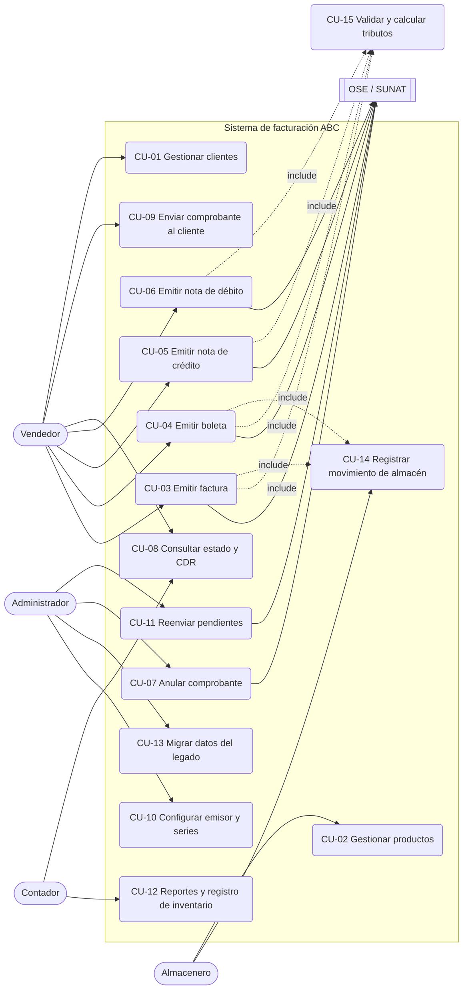
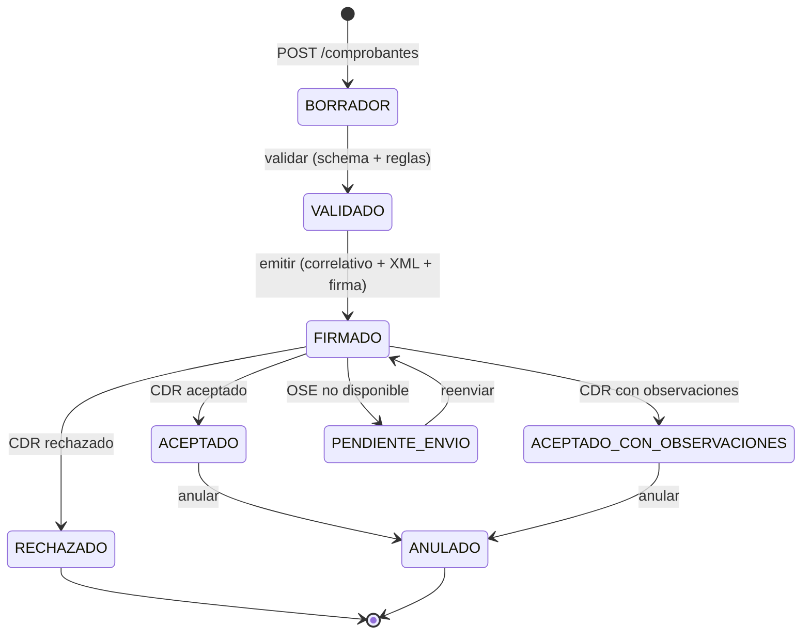

# 01 · Casos de uso

Fuente: análisis del caso, brechas del legado (`specs/00-contexto`) y benchmark Nubefact (`docs/benchmark`).

## Actores
| Actor | Descripción |
|---|---|
| **Vendedor** | Emite comprobantes en mostrador (Windows) o en ruta (Android). |
| **Almacenero** | Registra ingresos y salidas de mercadería. |
| **Administrador** | Configura emisor, series, certificado, OSE y catálogos; ejecuta la migración. |
| **Contador** | Consulta comprobantes, reportes y el registro de inventario (Formato 12.1). |
| **OSE / SUNAT** | Sistema externo que valida el CPE y devuelve el CDR. |
| **Padrón RUC** | Fuente externa para validar estado/condición del contribuyente (opcional). |

## Diagrama

## Casos de uso detallados

### CU-03 Emitir factura (caso principal)
| Campo | Detalle |
|---|---|
| Actor | Vendedor; secundario: OSE/SUNAT |
| Precondiciones | Emisor configurado con RUC, certificado y serie `F###` activa (CU-10). Productos con afectación IGV definida. |
| Disparador | El cliente con RUC solicita factura. |
| Contrato API | `POST /comprobantes` con `tipoComprobante = "01"` → `POST /comprobantes/{id}/emitir` |
| Flujo principal | 1. Vendedor busca o registra al cliente por RUC (R-10, R-11). 2. Agrega ítems: producto, cantidad, precio. 3. El sistema calcula por línea ISC (si aplica, cat. 08), IGV (cat. 07) e ICBPER (CU-15). 4. Muestra totales y leyenda en letras. 5. Vendedor confirma. 6. El sistema asigna correlativo (R-03), genera XML UBL 2.1 y lo valida contra el XSD (R-50). 7. Firma (R-51) y envía al OSE (R-52). 8. Recibe CDR aceptado: estado `ACEPTADO`. 9. Registra la salida de almacén (CU-14) referenciando el comprobante. 10. Genera PDF con QR. |
| Flujos alternos | A1 RUC inválido → mensaje y no permite continuar. A2 Producto sujeto a ISC sin sistema cat. 08 → error de configuración. A3 OSE no responde → estado `PENDIENTE_ENVIO`, entra a la cola (CU-11). A4 CDR rechazado → estado `RECHAZADO` con código y descripción SUNAT; no descuenta stock. A5 CDR con observaciones → `ACEPTADO_CON_OBSERVACIONES`. |
| Postcondiciones | Comprobante persistido con XML firmado, hash, CDR y estado. Movimiento de inventario trazable al comprobante. |
| Reglas | R-01–R-03, R-10, R-11, R-20–R-34, R-50–R-53 |

### CU-04 Emitir boleta
Igual que CU-03 con estas diferencias: serie `B###`; adquirente con DNI u otro documento del cat. 06
(R-12); en mostrador puede ser "cliente varios" bajo el umbral. Contrato: `POST /comprobantes` con `tipoComprobante = "03"`.

### CU-05 Emitir nota de crédito
| Campo | Detalle |
|---|---|
| Precondiciones | Existe el comprobante afectado en estado `ACEPTADO` (R-41). |
| Flujo principal | 1. Selecciona el comprobante afectado. 2. Elige motivo del cat. 09 y escribe el sustento (R-40). 3. Según motivo: anulación total (01, 02, 06), parcial por ítem (05, 07) o descuento (04, 09). 4. El sistema valida importe ≤ saldo (R-42). 5. Genera `CreditNote` UBL con `cac:BillingReference` y `cac:DiscrepancyResponse`, firma y envía. 6. Si es devolución (06, 07), registra ingreso de almacén (CU-14). |
| Contrato API | `POST /comprobantes/{id}/notas-credito` |

### CU-06 Emitir nota de débito
Como CU-05 con motivo del cat. 10 (intereses por mora, aumento de valor, penalidades). Genera `DebitNote`.
Contrato: `POST /comprobantes/{id}/notas-debito`.

### CU-07 Anular comprobante
Anulación de un comprobante aceptado por comunicación de baja (facturas) o resumen diario (boletas),
según canal y norma vigente. Contrato: `POST /comprobantes/{id}/anular`. Restringido al Administrador.

### CU-08 Consultar estado y CDR
Busca por tipo, serie, correlativo, fecha o cliente. Muestra estado y permite descargar XML, PDF y CDR.
Contratos: `GET /comprobantes`, `GET /comprobantes/{id}`, `GET /comprobantes/{id}/xml|cdr|pdf`.

### CU-09 Enviar comprobante al cliente
Envía PDF + XML al correo del cliente. Contrato: `POST /comprobantes/{id}/enviar-correo`.

### CU-10 Configurar emisor y series
Registra RUC, razón social, domicilio fiscal (ubigeo), certificado digital, credenciales del OSE y series
por tipo de comprobante y punto de venta. Contratos: `GET|PUT /configuracion/emisor`, `GET|POST /series`.

### CU-11 Reenviar pendientes
Proceso que reintenta los comprobantes `PENDIENTE_ENVIO` respetando el plazo de envío (R-05).
Contrato: `POST /comprobantes/reenviar-pendientes`.

### CU-12 Reportes y registro de inventario
Reporte de ventas por período y **Registro de Inventario Permanente en Unidades Físicas (Formato 12.1,
RS 234-2006)** por producto y almacén. Contratos: `GET /reportes/ventas`, `GET /inventario/kardex`.

### CU-13 Migrar datos del legado
Importa el histórico del almacén, aplica reglas M-01…M-07, deja en cuarentena lo no migrable y produce
un reporte de trazabilidad legado → nuevo. Contratos: `POST /migraciones`, `GET /migraciones/{id}`,
`GET /migraciones/{id}/trazabilidad`. Detalle en `specs/06-migracion/`.

### CU-14 Registrar movimiento de almacén
Registra ingreso, salida o ajuste. Toda salida por venta referencia un comprobante; los ingresos
referencian guía o comprobante de compra. Contrato: `POST /inventario/movimientos`.

### CU-15 Validar y calcular tributos (incluido)
Para cada ítem: 1) determina tributo por afectación (R-22, R-23); 2) calcula ISC según cat. 08 (R-24);
3) calcula IGV sobre (valor + ISC) (R-25); 4) calcula ICBPER (R-26); 5) redondea (R-28);
6) totaliza (R-30, R-31). Contrato: `POST /comprobantes/validar` (previsualización sin emitir).

## Estados del comprobante

