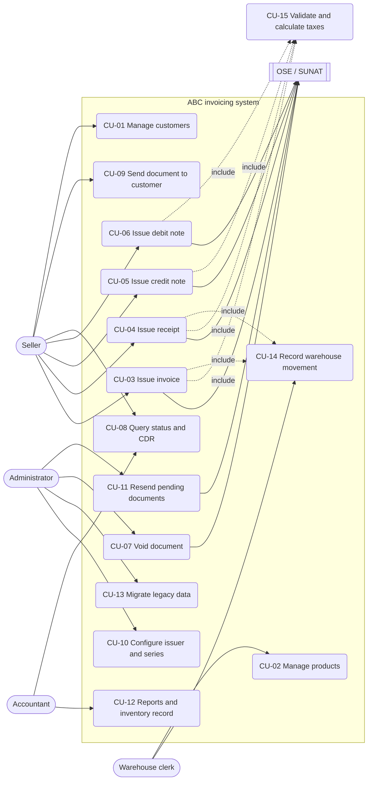
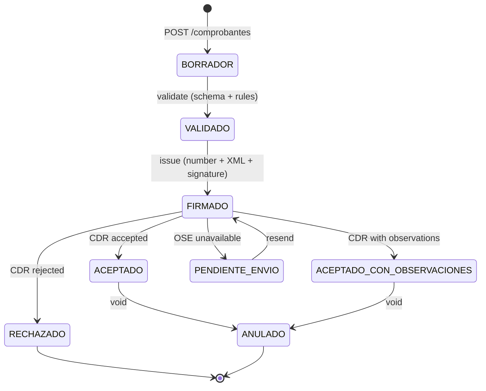

# 01 · Use cases

Sources: case analysis, legacy gaps (`specs/00-contexto`) and the Nubefact benchmark (`docs/benchmark`).

## Actors
| Actor | Description |
|---|---|
| **Seller** | Issues documents at the counter (Windows) or on route (Android). |
| **Warehouse clerk** | Records goods inputs and outputs. |
| **Administrator** | Configures issuer, series, certificate, OSE and catalogs; runs the migration. |
| **Accountant** | Queries documents, reports and the inventory record (Format 12.1). |
| **OSE / SUNAT** | External system that validates the document and returns the CDR. |
| **RUC registry** | External source to validate taxpayer status (optional). |

## Diagram

## Detailed use cases

### CU-03 Issue invoice (main use case)
| Field | Detail |
|---|---|
| Actor | Seller; secondary: OSE/SUNAT |
| Preconditions | Issuer configured with RUC, certificate and an active `F###` series (CU-10). Products with IGV treatment defined. |
| Trigger | A customer with RUC requests an invoice. |
| API contract | `POST /comprobantes` with `tipoComprobante = "01"` → `POST /comprobantes/{id}/emitir` |
| Main flow | 1. Seller finds or registers the customer by RUC (R-10, R-11). 2. Adds items: product, quantity, price. 3. The system computes per line ISC (if any, cat. 08), IGV (cat. 07) and ICBPER (CU-15). 4. Shows totals and amount-in-words legend. 5. Seller confirms. 6. The system assigns the number (R-03), generates UBL 2.1 XML and validates it against the XSD (R-50). 7. Signs (R-51) and sends to the OSE (R-52). 8. Receives an accepted CDR: status `ACEPTADO`. 9. Records the warehouse output (CU-14) referencing the document. 10. Generates a PDF with QR code. |
| Alternative flows | A1 Invalid RUC → message, cannot continue. A2 ISC product without a cat. 08 system → configuration error. A3 OSE does not respond → status `PENDIENTE_ENVIO`, queued (CU-11). A4 Rejected CDR → status `RECHAZADO` with SUNAT code and description; stock is not deducted. A5 CDR with observations → `ACEPTADO_CON_OBSERVACIONES`. |
| Postconditions | Document stored with signed XML, hash, CDR and status. Inventory movement traceable to the document. |
| Rules | R-01–R-03, R-10, R-11, R-20–R-34, R-50–R-53 |

### CU-04 Issue receipt (boleta)
Same as CU-03 with these differences: series `B###`; customer with DNI or another cat. 06 document
(R-12); at the counter it can be a generic customer below the threshold. Contract: `POST /comprobantes` with `tipoComprobante = "03"`.

### CU-05 Issue credit note
| Field | Detail |
|---|---|
| Preconditions | The affected document exists with status `ACEPTADO` (R-41). |
| Main flow | 1. Select the affected document. 2. Choose a cat. 09 reason and write the justification (R-40). 3. Depending on the reason: full void (01, 02, 06), partial per item (05, 07) or discount (04, 09). 4. The system checks amount ≤ balance (R-42). 5. Generates a UBL `CreditNote` with `cac:BillingReference` and `cac:DiscrepancyResponse`, signs and sends it. 6. For returns (06, 07), records a warehouse input (CU-14). |
| API contract | `POST /comprobantes/{id}/notas-credito` |

### CU-06 Issue debit note
Like CU-05 with a cat. 10 reason (late-payment interest, price increase, penalties). Generates a `DebitNote`.
Contract: `POST /comprobantes/{id}/notas-debito`.

### CU-07 Void document
Voiding an accepted document through a voiding communication (invoices) or daily summary (receipts),
depending on channel and current regulation. Contract: `POST /comprobantes/{id}/anular`. Administrator only.

### CU-08 Query status and CDR
Search by type, series, number, date or customer. Shows status and allows downloading XML, PDF and CDR.
Contracts: `GET /comprobantes`, `GET /comprobantes/{id}`, `GET /comprobantes/{id}/xml|cdr|pdf`.

### CU-09 Send document to customer
Sends PDF + XML to the customer's email. Contract: `POST /comprobantes/{id}/enviar-correo`.

### CU-10 Configure issuer and series
Registers RUC, legal name, registered address (ubigeo), digital certificate, OSE credentials and series
per document type and point of sale. Contracts: `GET|PUT /configuracion/emisor`, `GET|POST /series`.

### CU-11 Resend pending documents
Process that retries `PENDIENTE_ENVIO` documents within the submission deadline (R-05).
Contract: `POST /comprobantes/reenviar-pendientes`.

### CU-12 Reports and inventory record
Sales report per period and **Permanent Inventory Record in Physical Units (Format 12.1,
RS 234-2006)** per product and warehouse. Contracts: `GET /reportes/ventas`, `GET /inventario/kardex`.

### CU-13 Migrate legacy data
Imports the warehouse history, applies rules M-01…M-07, quarantines what cannot be migrated and produces
a legacy → new traceability report. Contracts: `POST /migraciones`, `GET /migraciones/{id}`,
`GET /migraciones/{id}/trazabilidad`. Details in `specs/06-migracion/`.

### CU-14 Record warehouse movement
Records an input, output or adjustment. Every sales output references a document; inputs reference a
dispatch guide or purchase document. Contract: `POST /inventario/movimientos`.

### CU-15 Validate and calculate taxes (included)
For each line: 1) determine the tax by IGV treatment (R-22, R-23); 2) compute ISC per cat. 08 (R-24);
3) compute IGV on (value + ISC) (R-25); 4) compute ICBPER (R-26); 5) round (R-28);
6) total (R-30, R-31). Contract: `POST /comprobantes/validar` (preview without issuing).

## Document states

