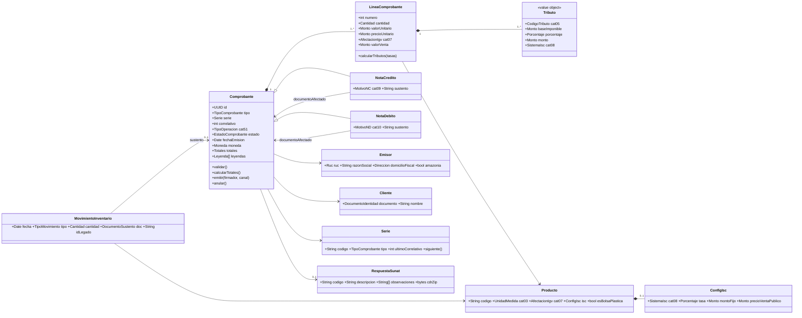

# 02 · Domain model and data contracts

## 1. Aggregates and responsibilities
| Aggregate / entity | Responsibility | Main invariants |
|---|---|---|
| **Comprobante** (root, tax document) | Lifecycle of invoice, receipt, credit and debit notes | Unique number per series (R-03); totals = Σ lines (R-30, R-31); valid state transitions |
| LineaComprobante | Line item sold with its taxes | Consistent IGV treatment ↔ tax (R-22, R-23); ISC before IGV (R-25) |
| Tributo (VO) | IGV, ISC, ICBPER, EXO, INA, EXP | Code ∈ catalog 05; ISC requires a catalog 08 system |
| Emisor | Issuer (taxpayer) data and configuration | Valid RUC (R-10) |
| Cliente | Customer | ID document consistent with the document type (R-11, R-12) |
| Producto | Product master and tax configuration | Treatment ∈ catalog 07; if ISC → parameters per catalog 08 |
| Serie | Numbering per document type | Format `F###` / `B###`; monotonic number |
| MovimientoInventario | Format 12.1 inventory record | Every sales output references a document |
| Migracion | Legacy import | Every legacy row ends MIGRADO, CUARENTENA or DESCARTADO |

**Value objects:** `Ruc`, `NumeroComprobante`, `Monto` (exact decimal, never float), `Cantidad`,
`CodigoCatalogo<N>`, `DocumentoIdentidad`, `Leyenda`.

## 2. Class diagram

## 3. Per-line calculation algorithm (CU-15)
Input: `cantidad`, `precioUnitario` (tax-inclusive, catalog 16 = 01), product (IGV treatment, ISC, bag).

1. Treatment 10–17 **without ISC**: `valorUnitario = precioUnitario / 1.18`.
2. Treatment 10–17 **with ISC** (catalog 08): solve the unit value from the system formula —
   01: `precio / ((1 + isc rate) × 1.18)`; 02: `precio / 1.18 − fixed amount`; 03: `precio / 1.18 − PVP × 0.847 × rate`.
3. Treatment 20–40: `valorUnitario = precioUnitario` (no IGV).
4. `valorVenta = round2(cantidad × valorUnitario − discount)`.
5. `isc = round2(catalog 08 formula)`: 01 value × rate · 02 quantity × fixed amount · 03 retail price × 0.847 × rate × quantity.
6. `igv = round2((valorVenta + isc) × 0.18)` only if taxed (R-25).
7. `icbper = bags × ICBPER rate` if the product is a plastic bag (R-26, D-01).

Verified examples:
- `ejemplos/comprobante.factura.json` line 2 (system 01): price 7.08 → value 5.00 · sale value 60.00 · ISC 12.00 · IGV 12.96.
- `ejemplos/comprobante.factura-isc.json` line 1 (system 02): 12 × 1.50 = ISC 18.00 · IGV (48 + 18) × 18 % = 11.88.
- `ejemplos/comprobante.factura-isc.json` line 2 (system 03): 12.00 × 0.847 × 20 % × 5 = ISC 10.16 · IGV 9.03.

The displayed unit price includes IGV and ISC; ICBPER is totalled separately (D-10).

## 4. Data contracts (JSON Schema 2020-12)
| Schema | Use | Use cases |
|---|---|---|
| `schemas/comun.schema.json` | Shared types and catalogs (`$defs`) | All |
| `schemas/emisor.schema.json` | Issuer | CU-10 |
| `schemas/cliente.schema.json` | Customer | CU-01 |
| `schemas/producto.schema.json` | Product + tax configuration | CU-02 |
| `schemas/comprobante-crear.schema.json` | **Request** create invoice/receipt | CU-03, CU-04 |
| `schemas/nota-crear.schema.json` | **Request** credit/debit note | CU-05, CU-06 |
| `schemas/comprobante.schema.json` | **Response** calculated document + status + CDR | CU-03…CU-08 |
| `schemas/movimiento-inventario.schema.json` | Format 12.1 movement | CU-14 |
| `schemas/registro-legado.schema.json` | Legacy row | CU-13 |
| `schemas/migracion.schema.json` | Migration result | CU-13 |
| `schemas/error.schema.json` | RFC 9457 error with rule ID | All |
| `schemas/evento.schema.json` | Domain events between microservices | `specs/04-api/eventos.md` |

Key decision: **the request carries no number and no totals**. The domain computes them, so no client
(Windows, Android or a future microservice) can send inconsistent amounts.

## 5. Examples
| File | Validates against |
|---|---|
| `ejemplos/comprobante-crear.factura.json`, `comprobante-crear.boleta.json` | `comprobante-crear.schema.json` |
| `ejemplos/comprobante.factura.json`, `.factura-isc`, `.boleta`, `.nota-credito`, `.nota-debito` | `comprobante.schema.json` |
| `ejemplos/factura-F001-1`, `factura-F001-2-isc`, `boleta-B001-1` `.sin-firma.xml` | UBL 2.1 Invoice XSD |
| `ejemplos/nota-credito-FC01-1.sin-firma.xml` / `nota-debito-FD01-1.sin-firma.xml` | UBL 2.1 CreditNote / DebitNote XSD |
| `ejemplos/nota-crear.credito.json`, `nota-crear.debito.json` | `nota-crear.schema.json` |
| `ejemplos/producto-*.json` | `producto.schema.json` |
| `ejemplos/movimiento-inventario.salida.json` | `movimiento-inventario.schema.json` |
| `ejemplos/error.validacion.json` | `error.schema.json` |
| `ejemplos/evento.comprobante-aceptado.json` | `evento.schema.json` |
