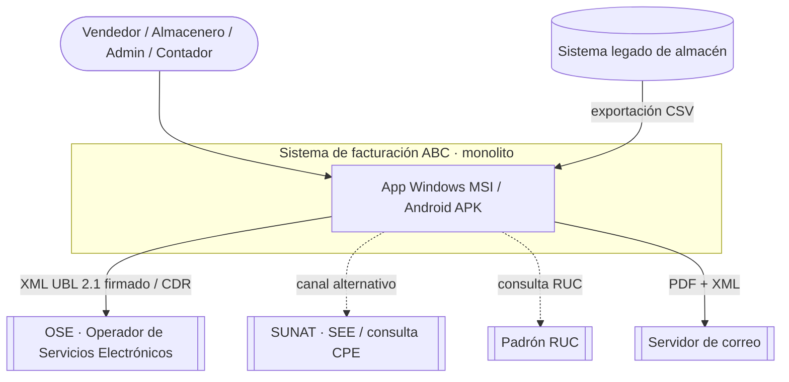
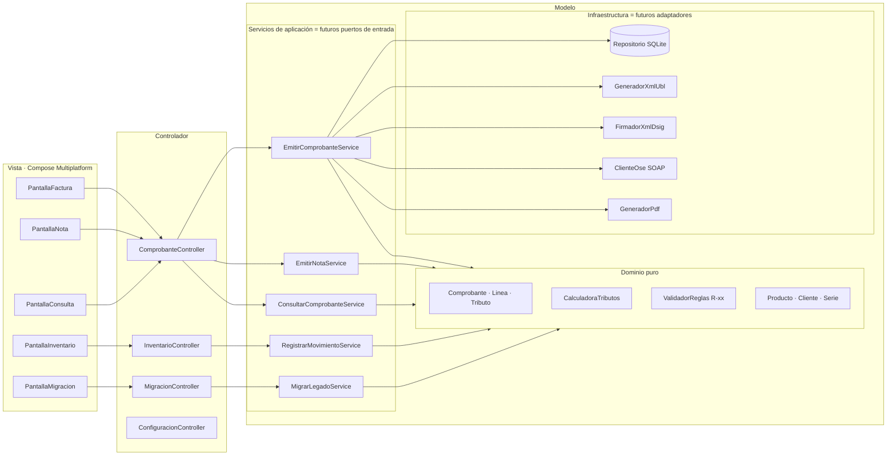
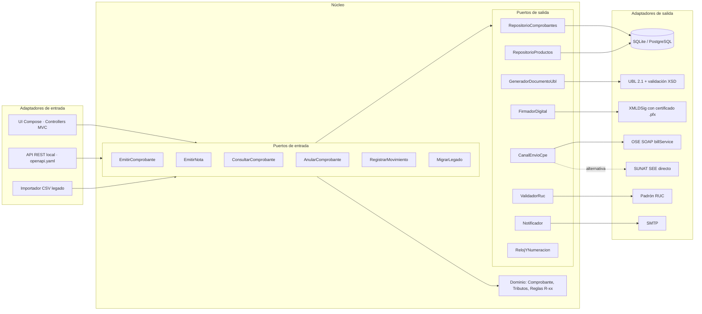
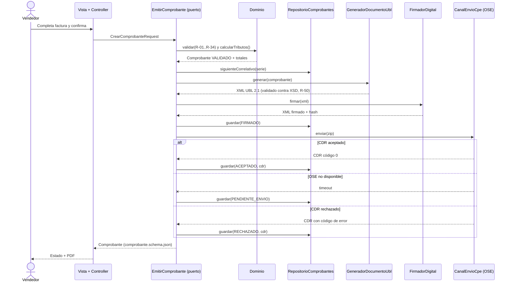
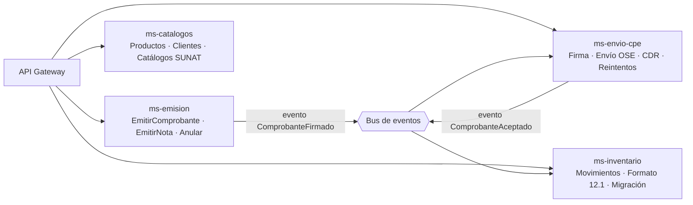

# 03 · Arquitectura: MVC monolítico con visión Hexagonal

## 1. Principio rector
El sistema se construye como **un monolito MVC**, pero el código se separa desde el día uno en
**núcleo (dominio + casos de uso)** y **detalles técnicos (UI, BD, XML, firma, OSE)**, comunicados por
**interfaces (puertos)**. Así:

- Hoy: el *Controlador* del MVC llama a un *Servicio de aplicación*; la *Vista* es Compose (Windows/Android).
- Mañana: ese mismo servicio es un **puerto de entrada** hexagonal y cada dependencia técnica es un **adaptador**.
- Después: cada grupo de puertos puede separarse en un **microservicio** sin reescribir el dominio.

La regla que lo hace posible (y que se verifica en revisión de código): **las dependencias apuntan hacia
el dominio**. El dominio no importa nada de UI, BD, HTTP, XML ni firma.

## 2. Contexto (C4 nivel 1)


## 3. Vista MVC actual (monolito)


## 4. La misma aplicación vista como Hexagonal


### Correspondencia MVC → Hexagonal (lo que se mantiene y lo que cambia)
| Pieza en el MVC de hoy | Rol en Hexagonal | ¿Cambia al migrar? |
|---|---|---|
| Vista Compose | Adaptador de entrada (UI) | No |
| Controller | Adaptador de entrada (traduce eventos UI → DTO) | No |
| Servicio de aplicación (`EmitirComprobanteService`) | Implementación del puerto de entrada | No; se le extrae la interfaz |
| Dominio (`Comprobante`, `CalculadoraTributos`) | Núcleo | **Nunca** |
| Repositorio, XML, firma, cliente OSE | Adaptadores de salida detrás de interfaces | Solo se cambian implementaciones |
| DTOs (`specs/02-dominio/schemas`) | Contratos de los puertos | No |

## 5. Estructura de módulos (aplicable desde el primer commit de código)
```
abc-facturacion/
├── dominio/            # Kotlin puro. Sin dependencias externas. Entidades, VO, reglas R-xx, cálculo.
├── aplicacion/         # Casos de uso + interfaces de puertos (entrada y salida). Depende solo de dominio.
├── adaptadores/
│   ├── persistencia/   # SQLite (SQLDelight) → implementa RepositorioComprobantes…
│   ├── ubl/            # Generación XML UBL 2.1 + validación XSD (R-50)
│   ├── firma/          # XMLDSig (R-51)
│   ├── envio-ose/      # SOAP sendBill / getStatus → CanalEnvioCpe
│   ├── pdf/            # Representación impresa
│   └── migracion/      # Lector CSV legado + reglas M-xx
├── ui/                 # Compose Multiplatform: Vistas + Controllers (MVC)
├── app-desktop/        # Punto de entrada Windows → instalador MSI
└── app-android/        # Punto de entrada Android → APK
```
Regla de dependencias, verificable con una prueba de arquitectura (ArchUnit/Konsist):
`ui → aplicacion → dominio` y `adaptadores → aplicacion → dominio`. `dominio` no depende de nada.

## 6. Secuencia: emitir factura (CU-03)


## 7. Evolución a microservicios (cuando la empresa crezca)

Cada microservicio es **un grupo de puertos de entrada que ya existe en el monolito**. Las llamadas
en proceso entre servicios se reemplazan por los contratos de `specs/04-api/openapi.yaml` y por eventos.
El dominio y los DTOs no cambian.

## 8. Decisiones relacionadas
ADR-001 (MVC con puertos), ADR-002 (stack multiplataforma), ADR-003 (persistencia),
ADR-004 (canal OSE/SUNAT), ADR-005 (Amazonía) en `specs/adr/`.
