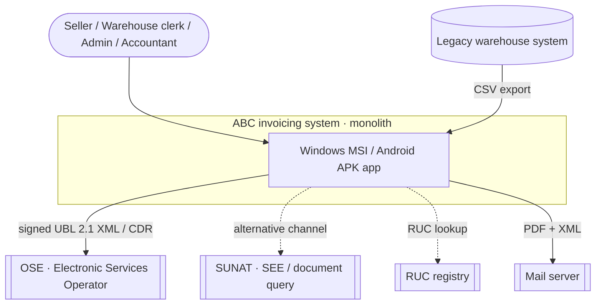
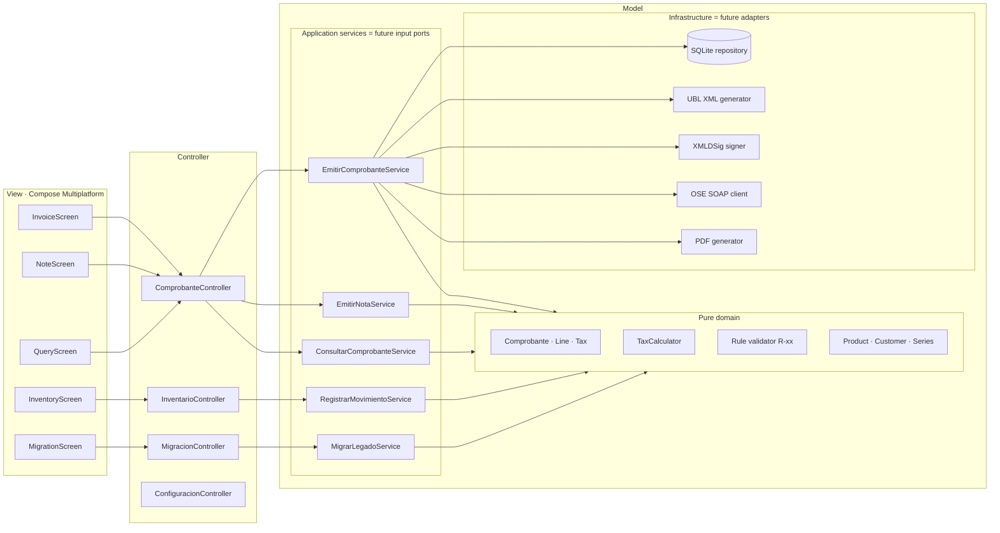
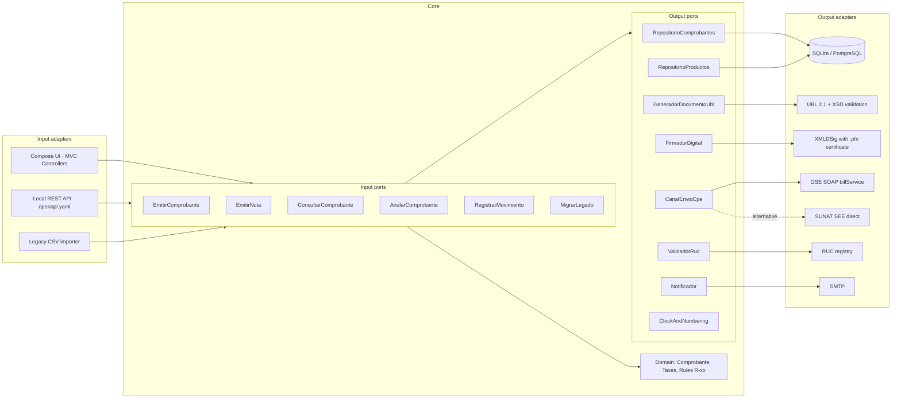
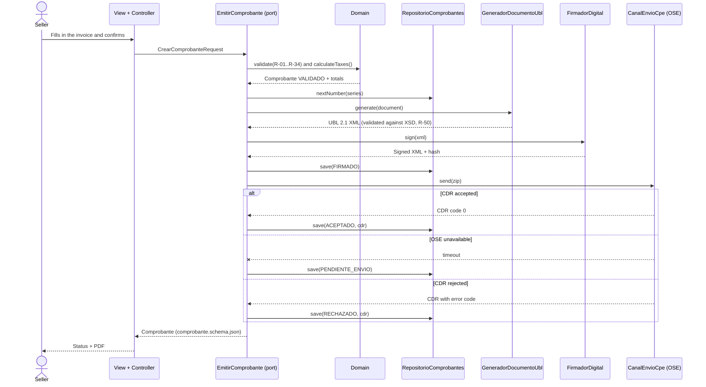
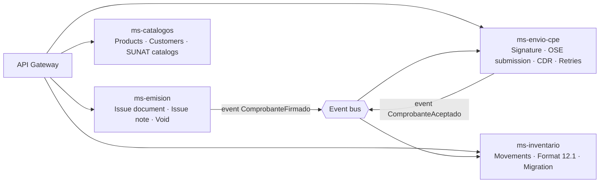

# 03 · Architecture: monolithic MVC with a Hexagonal vision

## 1. Guiding principle
The system is built as **an MVC monolith**, but from day one the code is split into the
**core (domain + use cases)** and **technical details (UI, DB, XML, signature, OSE)**, connected through
**interfaces (ports)**. Therefore:

- Today: the MVC *Controller* calls an *Application Service*; the *View* is Compose (Windows/Android).
- Tomorrow: that same service is a hexagonal **input port** and every technical dependency is an **adapter**.
- Later: each group of ports can be split into a **microservice** without rewriting the domain.

The rule that makes this possible (enforced in code review and by an architecture test): **dependencies
point towards the domain**. The domain imports nothing from UI, DB, HTTP, XML or signature libraries.

## 2. Context (C4 level 1)


## 3. Current MVC view (monolith)


## 4. The same application seen as Hexagonal


### MVC → Hexagonal mapping (what stays and what changes)
| Piece in today's MVC | Role in Hexagonal | Changes when migrating? |
|---|---|---|
| Compose View | Input adapter (UI) | No |
| Controller | Input adapter (translates UI events → DTO) | No |
| Application service (`EmitirComprobanteService`) | Input port implementation | No; its interface is extracted |
| Domain (`Comprobante`, tax calculator) | Core | **Never** |
| Repository, XML, signature, OSE client | Output adapters behind interfaces | Only implementations change |
| DTOs (`specs/02-dominio/schemas`) | Port contracts | No |

## 5. Module structure (applies from the first code commit)
```
abc-facturacion/
├── dominio/            # Pure Kotlin. No external deps. Entities, VOs, rules R-xx, calculation.
├── aplicacion/         # Use cases + port interfaces (input and output). Depends only on dominio.
├── adaptadores/
│   ├── persistencia/   # SQLite (SQLDelight) → implements RepositorioComprobantes…
│   ├── ubl/            # UBL 2.1 XML generation + XSD validation (R-50)
│   ├── firma/          # XMLDSig (R-51)
│   ├── envio-ose/      # SOAP sendBill / getStatus → CanalEnvioCpe
│   ├── pdf/            # Printed representation
│   └── migracion/      # Legacy CSV reader + rules M-xx
├── ui/                 # Compose Multiplatform: Views + Controllers (MVC)
├── app-desktop/        # Windows entry point → MSI installer
└── app-android/        # Android entry point → APK
```
Dependency rule, checked by an architecture test (ArchUnit/Konsist):
`ui → aplicacion → dominio` and `adaptadores → aplicacion → dominio`. `dominio` depends on nothing.

## 6. Sequence: issue an invoice (CU-03)


## 7. Evolution to microservices (when the company grows)

Each microservice is **a group of input ports that already exists in the monolith**. In-process calls
between services are replaced by the contracts in `specs/04-api/openapi.yaml` and by the events in
`specs/04-api/eventos.md`. The domain and the DTOs do not change.

## 8. Related decisions
ADR-001 (MVC with ports), ADR-002 (cross-platform stack), ADR-003 (persistence),
ADR-004 (OSE/SUNAT channel), ADR-005 (Amazon region) in `specs/adr/`.
