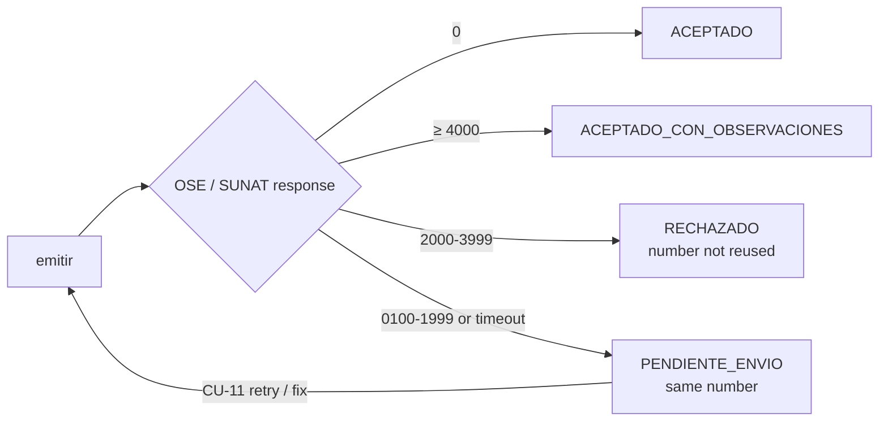

# 04 · Output port contracts

Interfaces defined by the core and implemented by adapters (`specs/03-arquitectura`, §4).
Written as Kotlin pseudocode: they are **contracts, not implementation**.

```kotlin
interface RepositorioComprobantes {            // document repository
    fun guardar(c: Comprobante)
    fun buscarPorId(id: UUID): Comprobante?
    fun buscarPorNumero(tipo: TipoComprobante, serie: Serie, correlativo: Int): Comprobante?
    fun siguienteCorrelativo(serie: Serie): Int          // atomic; R-03
    fun pendientesDeEnvio(limite: Int): List<Comprobante> // CU-11
}

interface GeneradorDocumentoUbl {      // implemented with JAXB classes generated by xjc from docs/ubl (ADR-006)
    /** Returns unsigned UBL 2.1 XML already validated against the XSD (R-50). Throws ErrorEstructuraUbl. */
    fun generar(c: Comprobante): DocumentoXml
}

interface FirmadorDigital {
    /** Enveloped XMLDSig signature inside ext:UBLExtensions (R-51). Returns signed XML and DigestValue. */
    fun firmar(xml: DocumentoXml, certificado: CertificadoDigital): DocumentoFirmado
}

interface CanalEnvioCpe {                 // ADR-004
    fun enviar(doc: DocumentoFirmado): ResultadoEnvio          // sendBill
    fun consultarEstado(ticketOClave: String): ResultadoEnvio  // getStatus / getStatusCdr
    fun enviarBaja(baja: ComunicacionBaja): Ticket             // sendSummary
}

sealed interface ResultadoEnvio {                                   // classified by R-54
    data class Aceptado(val cdr: Cdr, val observaciones: List<Observacion>) : ResultadoEnvio  // 0 or ≥ 4000
    data class Rechazado(val cdr: Cdr, val codigo: String, val descripcion: String) : ResultadoEnvio // 2000–3999
    data class Excepcion(val codigo: String, val descripcion: String, val reintentable: Boolean) : ResultadoEnvio // 0100–1999
    data class NoDisponible(val causa: String) : ResultadoEnvio   // timeout / no connection → PENDIENTE_ENVIO
}

interface PropuestaRegistroVentas {     // SIRE, ADR-007, R-76
    fun solicitarPropuesta(periodo: YearMonth): TicketSire          // exportapropuesta
    fun estadoTicket(ticket: TicketSire): EstadoTicket              // consultaestadotickets
    fun descargarPropuesta(ticket: TicketSire): RegistroVentas      // archivoreporte → rows normalized to registro-ventas.schema.json
    fun aceptarPropuesta(periodo: YearMonth): TicketSire            // aceptapropuesta (only if CONCILIADA)
}

interface ValidadorRuc { fun consultar(ruc: Ruc): EstadoContribuyente? }  // R-13, optional
interface Notificador  { fun enviarComprobante(c: Comprobante, correo: String) }
interface Reloj        { fun ahora(): ZonedDateTime }  // America/Lima; enables deterministic tests
```

## External contract: OSE / SUNAT (`envio-ose` adapter)
| Operation | Input | Output | Use |
|---|---|---|---|
| `sendBill` | `fileName` = `RUC-TYPE-SERIES-NUMBER.zip`, `contentFile` = base64 ZIP with the signed XML | `applicationResponse` = base64 ZIP with the CDR | Invoice, credit note, debit note (synchronous) |
| `sendSummary` | Daily summary / voiding communication ZIP | `ticket` | Receipts and voids (asynchronous) |
| `getStatus` | `ticket` | Status + CDR | Summary status query |

Protocol: SOAP 1.1 with WS-Security UsernameToken (secondary SOL user or OSE credential).
Decision (D-03, ADR-004): the adapter implements this SUNAT SEE contract; the endpoint URL and credentials of the chosen OSE
are configuration. An OSE with its own REST API is added as another adapter; the core only knows `CanalEnvioCpe`.

## Return-code ranges → status, number and retry (R-53, R-54, R-55)
Source: SUNAT SEE programmer manual, return-code list.

| Return code | Category (`respuestaSunat.categoria`) | Meaning | Document status | Number | Retry policy |
|---|---|---|---|---|---|
| `0` | `ACEPTADO` | Accepted | `ACEPTADO` | Consumed | — |
| `0100`–`1999` (SOAP fault) | `EXCEPCION` | The file could not be processed; the document counts as **not submitted** | `PENDIENTE_ENVIO` | **Kept** (same number) | Service codes (e.g. 0100, 0109) and timeouts: automatic retry with exponential backoff (1, 5, 15, 60 min) by CU-11. Format/content codes (1000–1999): fix and re-send with the same number before the deadline (R-05) |
| `2000`–`3999` | `RECHAZO` | Processed and **invalid** | `RECHAZADO` | Consumed, **never reused** | No retry with that number: the sale is issued again as a new document. Daily summaries / voiding communications: the file counts as not submitted and is re-sent with the same file name |
| `≥ 4000` | `OBSERVACION` | Valid, with observations | `ACEPTADO_CON_OBSERVACIONES` | Consumed | — (observations stored for review) |
| Timeout / no connection | — | Unknown whether it arrived | `PENDIENTE_ENVIO` | Kept | Query status first (`getStatusCdr`) to avoid a duplicate, then retry |



## External contract: SIRE – Sales Record (`sire` adapter, port `PropuestaRegistroVentas`)
Source: SUNAT, *Manual del servicio API del Registro de Ventas e Información Electrónica*, v30 (June 2026): https://cpe.sunat.gob.pe/sites/default/files/2026-06/Manual%20del%20servicio%20API%20del%20Registro%20de%20Ventas%20e%20Informaci%C3%B3n%20Electr%C3%B3nica.%20v30.pdf

| Step | Operation | Endpoint (official) | Notes |
|---|---|---|---|
| 1 | Token | `POST https://api-seguridad.sunat.gob.pe/v1/clientessol/{client_id}/oauth2/token/` | `grant_type=password`, `scope=https://api-sire.sunat.gob.pe`, `username` = RUC + SOL user, `password` = SOL password; `client_id` / `client_secret` from "Credenciales de API SUNAT" |
| 2 | Request proposal | `GET https://apisire.sunat.gob.pe/v1/contribuyente/migeigv/libros/rvie/propuesta/web/propuesta/{perTributario}/exportapropuesta?codTipoArchivo=0` | `perTributario` = AAAAMM; `codTipoArchivo` 0 = txt, 1 = xls; returns `numTicket` (AAAA99999999) |
| 3 | Ticket status | `GET …/v1/contribuyente/migeigv/libros/rvierce/gestionprocesosmasivos/web/masivo/consultaestadotickets` | `perIni`, `perFin`, `page`, `perPage`, `numTicket`; download when the process has finished |
| 4 | Download | `GET …/v1/contribuyente/migeigv/libros/rvierce/gestionprocesosmasivos/web/masivo/archivoreporte` | `nomArchivoReporte`, `codTipoArchivoReporte`, `codLibro=140000`; zipped file |
| 5 | Accept proposal | `POST https://apisire.sunat.gob.pe/v1/contribuyente/migeigv/libros/rvie/propuesta/web/propuesta/{perTributario}/aceptapropuesta` | Only after reconciliation is CONCILIADA (R-76); returns `numTicket` |
| — | Replace proposal | `…/v1/contribuyente/migeigv/libros/rvierce/receptorpropuesta/web/propuesta/upload` (TUS upload, `codLibro=140000`) | Replacement file `LE` + RUC + AAAAMM + `0014040002` + O I M `2.txt`, zipped; structure in RS 112-2021 Annex (not used while the internal record and the CPEs agree) |

All calls use `Authorization: Bearer {token}` and must be made from the server-side adapter (the manual warns against
browser clients). The proposal file (40 fields, RS 112-2021 Annex 2) is mapped field by field to `registro-ventas.schema.json` rows by
`tools/sire.py` (mapping table in ADR-007), so the reconciliation (`conciliacion-sire.schema.json`) compares like with like.
