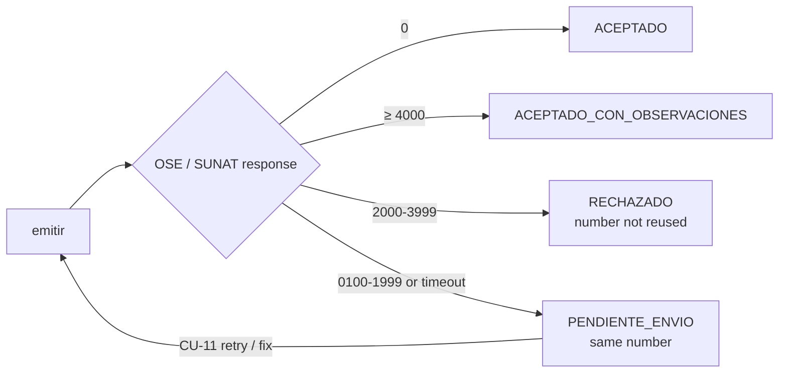

# 04 · Output port contracts

Interfaces defined by the core and implemented by adapters (`specs/03-arquitectura`, §4).
Written as Kotlin pseudocode: they are **contracts, not implementation**.

```kotlin
interface RepositorioComprobantes {            // document repository
    fun guardar(c: Comprobante)
    fun buscarPorId(id: UUID): Comprobante?
    fun buscarPorNumero(tipo: TipoComprobante, serie: Serie, correlativo: Int): Comprobante?
    fun siguienteCorrelativo(serie: Serie): Int          // atomic; R-03
    fun pendientesDeEnvio(limite: Int): List<Comprobante> // CU-11
}

interface GeneradorDocumentoUbl {      // implemented with JAXB classes generated by xjc from docs/ubl (ADR-006)
    /** Returns unsigned UBL 2.1 XML already validated against the XSD (R-50). Throws ErrorEstructuraUbl. */
    fun generar(c: Comprobante): DocumentoXml
}

interface FirmadorDigital {
    /** Enveloped XMLDSig signature inside ext:UBLExtensions (R-51). Returns signed XML and DigestValue. */
    fun firmar(xml: DocumentoXml, certificado: CertificadoDigital): DocumentoFirmado
}

interface CanalEnvioCpe {                 // ADR-004
    fun enviar(doc: DocumentoFirmado): ResultadoEnvio          // sendBill
    fun consultarEstado(ticketOClave: String): ResultadoEnvio  // getStatus / getStatusCdr
    fun enviarBaja(baja: ComunicacionBaja): Ticket             // sendSummary
}

sealed interface ResultadoEnvio {                                   // classified by R-54
    data class Aceptado(val cdr: Cdr, val observaciones: List<Observacion>) : ResultadoEnvio  // 0 or ≥ 4000
    data class Rechazado(val cdr: Cdr, val codigo: String, val descripcion: String) : ResultadoEnvio // 2000–3999
    data class Excepcion(val codigo: String, val descripcion: String, val reintentable: Boolean) : ResultadoEnvio // 0100–1999
    data class NoDisponible(val causa: String) : ResultadoEnvio   // timeout / no connection → PENDIENTE_ENVIO
}

interface ValidadorRuc { fun consultar(ruc: Ruc): EstadoContribuyente? }  // R-13, optional
interface Notificador  { fun enviarComprobante(c: Comprobante, correo: String) }
interface Reloj        { fun ahora(): ZonedDateTime }  // America/Lima; enables deterministic tests
```

## External contract: OSE / SUNAT (`envio-ose` adapter)
| Operation | Input | Output | Use |
|---|---|---|---|
| `sendBill` | `fileName` = `RUC-TYPE-SERIES-NUMBER.zip`, `contentFile` = base64 ZIP with the signed XML | `applicationResponse` = base64 ZIP with the CDR | Invoice, credit note, debit note (synchronous) |
| `sendSummary` | Daily summary / voiding communication ZIP | `ticket` | Receipts and voids (asynchronous) |
| `getStatus` | `ticket` | Status + CDR | Summary status query |

Protocol: SOAP 1.1 with WS-Security UsernameToken (secondary SOL user or OSE credential).
The exact endpoint and credentials depend on the chosen OSE (open question D-03); that is why the core
only knows `CanalEnvioCpe`.

## Return-code ranges → status, number and retry (R-53, R-54, R-55)
Source: SUNAT SEE programmer manual, return-code list.

| Return code | Category (`respuestaSunat.categoria`) | Meaning | Document status | Number | Retry policy |
|---|---|---|---|---|---|
| `0` | `ACEPTADO` | Accepted | `ACEPTADO` | Consumed | — |
| `0100`–`1999` (SOAP fault) | `EXCEPCION` | The file could not be processed; the document counts as **not submitted** | `PENDIENTE_ENVIO` | **Kept** (same number) | Service codes (e.g. 0100, 0109) and timeouts: automatic retry with exponential backoff (1, 5, 15, 60 min) by CU-11. Format/content codes (1000–1999): fix and re-send with the same number before the deadline (R-05) |
| `2000`–`3999` | `RECHAZO` | Processed and **invalid** | `RECHAZADO` | Consumed, **never reused** | No retry with that number: the sale is issued again as a new document. Daily summaries / voiding communications: the file counts as not submitted and is re-sent with the same file name |
| `≥ 4000` | `OBSERVACION` | Valid, with observations | `ACEPTADO_CON_OBSERVACIONES` | Consumed | — (observations stored for review) |
| Timeout / no connection | — | Unknown whether it arrived | `PENDIENTE_ENVIO` | Kept | Query status first (`getStatusCdr`) to avoid a duplicate, then retry |


