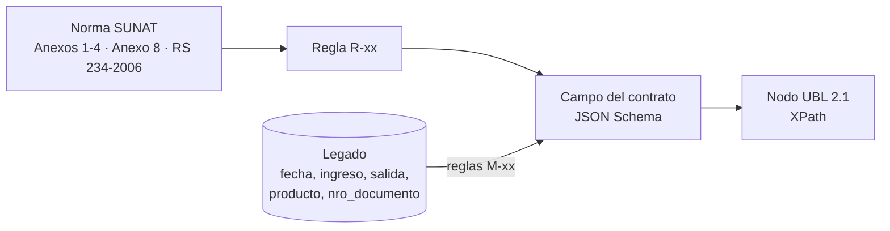

# 05 · Matriz de trazabilidad normativa (SUNAT ↔ UBL ↔ Dominio ↔ Legado)

> Archivo generado desde `matriz.csv` con `python3 tools/generar_matriz_md.py`. No editar a mano.

Cada fila responde: **qué exige SUNAT**, **dónde va en el XML UBL 2.1**, **qué campo del contrato lo
transporta**, **de qué dato del legado proviene** y **qué regla lo valida**. `tools/verificar.py`
comprueba automáticamente que:

1. cada `campo_dominio` exista en el JSON Schema indicado,
2. cada `xpath_ubl` exista en el XML de ejemplo correspondiente (factura o nota de crédito),
3. cada `regla` exista en `docs/sunat/reglas-validacion.md`, en `specs/06-migracion` o en los casos de uso,
4. cada `catalogo` exista en `docs/sunat/catalogos/`.

Abreviaturas: `L` = `/Invoice/cac:InvoiceLine`, `TS` = `L/cac:TaxTotal/cac:TaxSubtotal`.
En notas de crédito el prefijo es `/CreditNote` y la línea es `cac:CreditNoteLine`.

| ID | Dato SUNAT | Comp. | Cat. | Regla | XPath UBL 2.1 | Campo del contrato | Campo legado | Validación | Fuente |
|---|---|---|---|---|---|---|---|---|---|
| T-01 | Versión UBL | 01,03,07,08 |  | R-50 | `/Invoice/cbc:UBLVersionID` | `(constante 2.1)` |  | Fijo = 2.1 | Anexo 1 |
| T-02 | Versión de la estructura | 01,03,07,08 |  | R-50 | `/Invoice/cbc:CustomizationID` | `(constante 2.0)` |  | Fijo = 2.0 | Anexo 1 |
| T-03 | Serie y número | 01,03,07,08 |  | R-02,R-03 | `/Invoice/cbc:ID` | `/numero` | nro_documento | Serie F###/B###, correlativo 1-99999999 | Anexo 1 |
| T-04 | Fecha de emisión | 01,03,07,08 |  | R-05 | `/Invoice/cbc:IssueDate` | `/fechaEmision` | fecha | YYYY-MM-DD, no futura | Anexo 1 |
| T-05 | Hora de emisión | 01,03,07,08 |  |  | `/Invoice/cbc:IssueTime` | `/horaEmision` |  | HH:mm:ss | Anexo 1 |
| T-06 | Tipo de comprobante | 01,03 | 01 | R-01 | `/Invoice/cbc:InvoiceTypeCode` | `/tipoComprobante` | nro_documento (prefijo F/B) | ∈ cat. 01 | Anexo 1, cat. 01 |
| T-07 | Tipo de operación | 01,03 | 51 | R-34 | `/Invoice/cbc:InvoiceTypeCode/@listID` | `/tipoOperacion` |  | ∈ cat. 51 | Anexo 1 (2022), cat. 51 |
| T-08 | Leyenda monto en letras | 01,03,07,08 | 52 | R-32 | `/Invoice/cbc:Note[@languageLocaleID='1000']` | `/leyendas/*/texto` |  | Obligatoria código 1000 | Cat. 52 |
| T-09 | Moneda | 01,03,07,08 | 02 | R-33 | `/Invoice/cbc:DocumentCurrencyCode` | `/moneda` |  | ISO 4217 ∈ cat. 02 | Cat. 02 |
| T-10 | RUC del emisor | 01,03,07,08 | 06 | R-10 | `/Invoice/cac:AccountingSupplierParty/cac:Party/cac:PartyIdentification/cbc:ID` | `/emisor/ruc` |  | 11 dígitos + dígito verificador | Anexo 1 |
| T-11 | Tipo de doc. del emisor | 01,03,07,08 | 06 | R-10 | `/Invoice/cac:AccountingSupplierParty/cac:Party/cac:PartyIdentification/cbc:ID/@schemeID` | `(constante 6)` |  | = 6 (RUC) | Cat. 06 |
| T-12 | Razón social del emisor | 01,03,07,08 |  |  | `/Invoice/cac:AccountingSupplierParty/cac:Party/cac:PartyLegalEntity/cbc:RegistrationName` | `/emisor/razonSocial` |  | Obligatorio | Anexo 1 |
| T-13 | Código de establecimiento | 01,03 |  |  | `/Invoice/cac:AccountingSupplierParty/cac:Party/cac:PartyLegalEntity/cac:RegistrationAddress/cbc:AddressTypeCode` | `/emisor/domicilioFiscal/codigoEstablecimiento` |  | 4 dígitos; 0000 = domicilio fiscal | Anexo 1 |
| T-14 | Tipo de doc. del adquirente | 01,03,07,08 | 06 | R-11,R-12 | `/Invoice/cac:AccountingCustomerParty/cac:Party/cac:PartyIdentification/cbc:ID/@schemeID` | `/cliente/documento/tipo` |  | Factura = 6 | Cat. 06 |
| T-15 | Número de doc. del adquirente | 01,03,07,08 |  | R-10,R-12 | `/Invoice/cac:AccountingCustomerParty/cac:Party/cac:PartyIdentification/cbc:ID` | `/cliente/documento/numero` |  | RUC válido / DNI 8 dígitos | Anexo 1 |
| T-16 | Nombre del adquirente | 01,03,07,08 |  |  | `/Invoice/cac:AccountingCustomerParty/cac:Party/cac:PartyLegalEntity/cbc:RegistrationName` | `/cliente/nombre` |  | Obligatorio | Anexo 1 |
| T-17 | Número de ítem | 01,03,07,08 |  |  | `L/cbc:ID` | `/lineas/*/numero` |  | Secuencial desde 1 | Anexo 1 |
| T-18 | Cantidad | 01,03,07,08 |  | R-20 | `L/cbc:InvoicedQuantity` | `/lineas/*/cantidad` | salida | > 0, hasta 10 decimales | Anexo 1 |
| T-19 | Unidad de medida | 01,03,07,08 | 03 | R-20 | `L/cbc:InvoicedQuantity/@unitCode` | `/lineas/*/unidadMedida` | producto (inferida) | ∈ cat. 03 | Cat. 03 |
| T-20 | Descripción del ítem | 01,03,07,08 |  |  | `L/cac:Item/cbc:Description` | `/lineas/*/descripcion` | producto | Obligatoria | Anexo 1 |
| T-21 | Código de producto | 01,03,07,08 |  |  | `L/cac:Item/cac:SellersItemIdentification/cbc:ID` | `/lineas/*/codigoProducto` | producto (normalizado M-03) |  | Anexo 1 |
| T-22 | Código producto SUNAT (UNSPSC) | 01,03 |  |  | `L/cac:Item/cac:CommodityClassification/cbc:ItemClassificationCode` | `/lineas/*/codigoSunat` |  | 8 dígitos | Anexo 1 (2018) |
| T-23 | Valor unitario (sin impuestos) | 01,03,07,08 |  | R-28 | `L/cac:Price/cbc:PriceAmount` | `/lineas/*/valorUnitario` |  | n(12,10) | Anexo 1 |
| T-24 | Precio unitario (con impuestos) | 01,03,07,08 | 16 | R-27 | `L/cac:PricingReference/cac:AlternativeConditionPrice/cbc:PriceAmount` | `/lineas/*/precioUnitario` |  | Cat. 16 = 01 | Anexo 1 |
| T-25 | Tipo de precio | 01,03,07,08 | 16 | R-27 | `L/cac:PricingReference/cac:AlternativeConditionPrice/cbc:PriceTypeCode` | `/lineas/*/tipoPrecio` |  | ∈ cat. 16 | Cat. 16 |
| T-26 | Valor de venta del ítem | 01,03,07,08 |  | R-28 | `L/cbc:LineExtensionAmount` | `/lineas/*/valorVenta` |  | = cantidad × valor unitario − descuento | Anexo 1 |
| T-27 | Afectación al IGV | 01,03,07,08 | 07 | R-21,R-22,R-23 | `TS/cac:TaxCategory/cbc:TaxExemptionReasonCode` | `/lineas/*/afectacionIgv` |  | ∈ cat. 07 | Cat. 07 |
| T-28 | Código de tributo | 01,03,07,08 | 05 | R-22,R-23 | `TS/cac:TaxCategory/cac:TaxScheme/cbc:ID` | `/lineas/*/tributos/*/codigo` |  | ∈ cat. 05 | Cat. 05 |
| T-29 | Nombre de tributo | 01,03,07,08 | 05 |  | `TS/cac:TaxCategory/cac:TaxScheme/cbc:Name` | `/lineas/*/tributos/*/nombre` |  | Según cat. 05 | Cat. 05 |
| T-30 | Código internacional de tributo | 01,03,07,08 | 05 |  | `TS/cac:TaxCategory/cac:TaxScheme/cbc:TaxTypeCode` | `/lineas/*/tributos/*/codigoInternacional` |  | VAT/EXC/OTH/FRE | Cat. 05 |
| T-31 | Base imponible del tributo | 01,03,07,08 |  | R-25 | `TS/cbc:TaxableAmount` | `/lineas/*/tributos/*/baseImponible` |  | IGV: valor + ISC | Anexo 1 |
| T-32 | Tasa del tributo | 01,03,07,08 |  | R-22,R-24 | `TS/cac:TaxCategory/cbc:Percent` | `/lineas/*/tributos/*/porcentaje` |  | IGV 18.00 | Anexo 1 |
| T-33 | Monto del tributo por ítem | 01,03,07,08 |  | R-28 | `TS/cbc:TaxAmount` | `/lineas/*/tributos/*/monto` |  | 2 decimales | Anexo 1 |
| T-34 | Sistema de cálculo del ISC | 01,03,07,08 | 08 | R-24 | `TS/cac:TaxCategory/cbc:TierRange` | `/lineas/*/tributos/*/sistemaIsc` | producto (M-06) | ∈ cat. 08 si tributo = 2000 | Cat. 08, Guía XML |
| T-35 | Cantidad de bolsas (ICBPER) | 01,03 | 03 | R-26 | `TS/cbc:BaseUnitMeasure` | `/lineas/*/tributos/*/cantidadBolsas` | salida (producto bolsa, M-06) | Entero ≥ 1 | Anexo 1 (2022) fila 37-A |
| T-36 | Monto unitario ICBPER | 01,03 |  | R-26 | `TS/cac:TaxCategory/cbc:PerUnitAmount` | `/lineas/*/tributos/*/montoPorUnidad` |  | = tasa vigente (D-01) | Anexo 1 (2022), Ley 30884 |
| T-37 | Total IGV | 01,03,07,08 | 05 | R-30 | `/Invoice/cac:TaxTotal/cac:TaxSubtotal[cac:TaxCategory/cac:TaxScheme/cbc:ID='1000']/cbc:TaxAmount` | `/totales/totalIgv` |  | Σ IGV de ítems | Anexo 1 |
| T-38 | Total ISC | 01,03,07,08 | 05 | R-30 | `/Invoice/cac:TaxTotal/cac:TaxSubtotal[cac:TaxCategory/cac:TaxScheme/cbc:ID='2000']/cbc:TaxAmount` | `/totales/totalIsc` |  | Σ ISC de ítems | Anexo 1 |
| T-39 | Total ICBPER | 01,03 | 05 | R-26 | `/Invoice/cac:TaxTotal/cac:TaxSubtotal[cac:TaxCategory/cac:TaxScheme/cbc:ID='7152']/cbc:TaxAmount` | `/totales/totalIcbper` |  | Σ ICBPER | Anexo 1 (2022) fila 49-A |
| T-40 | Total valor de venta | 01,03,07,08 |  | R-30 | `/Invoice/cac:LegalMonetaryTotal/cbc:LineExtensionAmount` | `/totales/valorVenta` |  | Σ valor de venta | Anexo 1 |
| T-41 | Total precio de venta | 01,03,07,08 |  | R-31 | `/Invoice/cac:LegalMonetaryTotal/cbc:TaxInclusiveAmount` | `/totales/precioVenta` |  | Valor + tributos | Anexo 1 |
| T-42 | Importe total | 01,03,07,08 |  | R-31 | `/Invoice/cac:LegalMonetaryTotal/cbc:PayableAmount` | `/totales/importeTotal` |  | = precio venta − desc. globales − anticipos | Anexo 1 |
| T-43 | Documento que modifica | 07,08 | 01 | R-41 | `/CreditNote/cac:BillingReference/cac:InvoiceDocumentReference/cbc:ID` | `/documentoAfectado/numero` |  | Existe y está aceptado | Anexo 3 |
| T-44 | Tipo de documento que modifica | 07,08 | 01 | R-41 | `/CreditNote/cac:BillingReference/cac:InvoiceDocumentReference/cbc:DocumentTypeCode` | `/documentoAfectado/tipoComprobante` |  | 01 o 03 | Anexo 3 |
| T-45 | Motivo de la nota | 07,08 | 09/10 | R-40 | `/CreditNote/cac:DiscrepancyResponse/cbc:ResponseCode` | `/motivoNota/codigo` |  | ∈ cat. 09 (NC) / 10 (ND) | Anexos 3 y 4 |
| T-46 | Sustento de la nota | 07,08 |  | R-40 | `/CreditNote/cac:DiscrepancyResponse/cbc:Description` | `/motivoNota/sustento` |  | Obligatorio | Anexos 3 y 4 |
| T-47 | Firma digital | 01,03,07,08 |  | R-51 | `/Invoice/ext:UBLExtensions/ext:UBLExtension/ext:ExtensionContent/ds:Signature` | `/firma/hash` |  | XMLDSig enveloped | RS 097-2012 |
| T-48 | Movimiento de inventario por venta | 01,03,07 |  | CU-14 | `(no va en el XML)` | `movimiento-inventario:/documentoSustento/numero` | nro_documento | Toda salida por venta referencia comprobante | RS 234-2006 Formato 12.1 |
| T-49 | Fecha del movimiento | — |  | CU-14 | `(no va en el XML)` | `movimiento-inventario:/fecha` | fecha | YYYY-MM-DD | RS 234-2006 Formato 12.1 |
| T-50 | Entrada / salida en unidades | — |  | CU-14 | `(no va en el XML)` | `movimiento-inventario:/cantidad` | ingreso / salida | > 0; el tipo indica el sentido | RS 234-2006 Formato 12.1 |
| T-51 | Tipo de movimiento | — |  | CU-14 | `(no va en el XML)` | `movimiento-inventario:/tipo` | ingreso / salida (derivado) | INGRESO, SALIDA, AJUSTE_* | RS 234-2006 Formato 12.1 |
| T-52 | Trazabilidad con el legado | — |  | M-07 | `(no va en el XML)` | `movimiento-inventario:/idLegado` | id | Toda fila legada trazable | Requisito del caso |

## Cobertura de los campos del legado

| Campo legado | Filas de la matriz |
|---|---|
| `fecha` | T-04, T-49 |
| `ingreso` | T-50, T-51 |
| `salida` | T-18, T-35, T-50, T-51 |
| `producto` | T-19, T-20, T-21, T-34, T-35 |
| `nro_documento` | T-03, T-06, T-48 |
| `id` | T-52 |

Detalle de transformación de cada campo: `specs/06-migracion/mapeo-legado.csv`.
