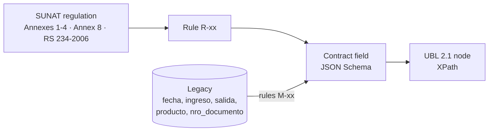

# 05 · Regulatory traceability matrix (SUNAT ↔ UBL ↔ Domain ↔ Legacy)

> Generated from `matriz.csv` with `python tools/generar_matriz_md.py`. Do not edit by hand.

Each row answers: **what SUNAT requires**, **where it goes in the UBL 2.1 XML**, **which contract field
carries it**, **which legacy field it comes from** and **which rule validates it**. `tools/verificar.py`
automatically checks that:

1. every `campo_dominio` exists in the given JSON Schema,
2. every `xpath_ubl` exists in the matching example XML (invoice or credit note),
3. every `regla` exists in `docs/sunat/reglas-validacion.md`, `specs/06-migracion` or the use cases,
4. every `catalogo` exists in `docs/sunat/catalogos/`.

Abbreviations: `L` = `/Invoice/cac:InvoiceLine`, `TS` = `L/cac:TaxTotal/cac:TaxSubtotal`.
In credit notes the prefix is `/CreditNote` and the line is `cac:CreditNoteLine`.

| ID | SUNAT data | Docs | Cat. | Rule | UBL 2.1 XPath | Contract field | Legacy field | Validation | Source |
|---|---|---|---|---|---|---|---|---|---|
| T-01 | UBL version | 01,03,07,08 |  | R-50 | `/Invoice/cbc:UBLVersionID` | `(constante 2.1)` |  | Fixed = 2.1 | Anexo 1 |
| T-02 | Structure (customization) version | 01,03,07,08 |  | R-50 | `/Invoice/cbc:CustomizationID` | `(constante 2.0)` |  | Fixed = 2.0 | Anexo 1 |
| T-03 | Series and number | 01,03,07,08 |  | R-02,R-03 | `/Invoice/cbc:ID` | `/numero` | nro_documento | Series F###/B###, number 1-99999999 | Anexo 1 |
| T-04 | Issue date | 01,03,07,08 |  | R-05 | `/Invoice/cbc:IssueDate` | `/fechaEmision` | fecha | YYYY-MM-DD, not in the future | Anexo 1 |
| T-05 | Issue time | 01,03,07,08 |  |  | `/Invoice/cbc:IssueTime` | `/horaEmision` |  | HH:mm:ss | Anexo 1 |
| T-06 | Document type | 01,03 | 01 | R-01 | `/Invoice/cbc:InvoiceTypeCode` | `/tipoComprobante` | nro_documento (F/B prefix) | ∈ cat. 01 | Anexo 1, cat. 01 |
| T-07 | Operation type | 01,03 | 51 | R-34 | `/Invoice/cbc:InvoiceTypeCode/@listID` | `/tipoOperacion` |  | ∈ cat. 51 | Anexo 1 (2022), cat. 51 |
| T-08 | Amount-in-words legend | 01,03,07,08 | 52 | R-32 | `/Invoice/cbc:Note[@languageLocaleID='1000']` | `/leyendas/*/texto` |  | Code 1000 mandatory | Cat. 52 |
| T-09 | Currency | 01,03,07,08 | 02 | R-33 | `/Invoice/cbc:DocumentCurrencyCode` | `/moneda` |  | ISO 4217 ∈ cat. 02 | Cat. 02 |
| T-10 | Issuer RUC | 01,03,07,08 | 06 | R-10 | `/Invoice/cac:AccountingSupplierParty/cac:Party/cac:PartyIdentification/cbc:ID` | `/emisor/ruc` |  | 11 digits + check digit | Anexo 1 |
| T-11 | Issuer ID document type | 01,03,07,08 | 06 | R-10 | `/Invoice/cac:AccountingSupplierParty/cac:Party/cac:PartyIdentification/cbc:ID/@schemeID` | `(constante 6)` |  | = 6 (RUC) | Cat. 06 |
| T-12 | Issuer legal name | 01,03,07,08 |  |  | `/Invoice/cac:AccountingSupplierParty/cac:Party/cac:PartyLegalEntity/cbc:RegistrationName` | `/emisor/razonSocial` |  | Mandatory | Anexo 1 |
| T-13 | Establishment code | 01,03 |  |  | `/Invoice/cac:AccountingSupplierParty/cac:Party/cac:PartyLegalEntity/cac:RegistrationAddress/cbc:AddressTypeCode` | `/emisor/domicilioFiscal/codigoEstablecimiento` |  | 4 digits; 0000 = registered address | Anexo 1 |
| T-14 | Customer ID document type | 01,03,07,08 | 06 | R-11,R-12 | `/Invoice/cac:AccountingCustomerParty/cac:Party/cac:PartyIdentification/cbc:ID/@schemeID` | `/cliente/documento/tipo` |  | Invoice = 6 | Cat. 06 |
| T-15 | Customer ID number | 01,03,07,08 |  | R-10,R-12 | `/Invoice/cac:AccountingCustomerParty/cac:Party/cac:PartyIdentification/cbc:ID` | `/cliente/documento/numero` |  | Valid RUC / 8-digit DNI | Anexo 1 |
| T-16 | Customer name | 01,03,07,08 |  |  | `/Invoice/cac:AccountingCustomerParty/cac:Party/cac:PartyLegalEntity/cbc:RegistrationName` | `/cliente/nombre` |  | Mandatory | Anexo 1 |
| T-17 | Line number | 01,03,07,08 |  |  | `L/cbc:ID` | `/lineas/*/numero` |  | Sequential from 1 | Anexo 1 |
| T-18 | Quantity | 01,03,07,08 |  | R-20 | `L/cbc:InvoicedQuantity` | `/lineas/*/cantidad` | salida | > 0, up to 10 decimals | Anexo 1 |
| T-19 | Unit of measure | 01,03,07,08 | 03 | R-20 | `L/cbc:InvoicedQuantity/@unitCode` | `/lineas/*/unidadMedida` | producto (inferred) | ∈ cat. 03 | Cat. 03 |
| T-20 | Item description | 01,03,07,08 |  |  | `L/cac:Item/cbc:Description` | `/lineas/*/descripcion` | producto | Mandatory | Anexo 1 |
| T-21 | Product code | 01,03,07,08 |  |  | `L/cac:Item/cac:SellersItemIdentification/cbc:ID` | `/lineas/*/codigoProducto` | producto (normalized M-03) |  | Anexo 1 |
| T-22 | SUNAT product code (UNSPSC) | 01,03 |  |  | `L/cac:Item/cac:CommodityClassification/cbc:ItemClassificationCode` | `/lineas/*/codigoSunat` |  | 8 digits | Anexo 1 (2018) |
| T-23 | Unit value (tax-exclusive) | 01,03,07,08 |  | R-28 | `L/cac:Price/cbc:PriceAmount` | `/lineas/*/valorUnitario` |  | n(12,10) | Anexo 1 |
| T-24 | Unit price (tax-inclusive) | 01,03,07,08 | 16 | R-27 | `L/cac:PricingReference/cac:AlternativeConditionPrice/cbc:PriceAmount` | `/lineas/*/precioUnitario` |  | Cat. 16 = 01 | Anexo 1 |
| T-25 | Price type | 01,03,07,08 | 16 | R-27 | `L/cac:PricingReference/cac:AlternativeConditionPrice/cbc:PriceTypeCode` | `/lineas/*/tipoPrecio` |  | ∈ cat. 16 | Cat. 16 |
| T-26 | Line sale value | 01,03,07,08 |  | R-28 | `L/cbc:LineExtensionAmount` | `/lineas/*/valorVenta` |  | = quantity × unit value − discount | Anexo 1 |
| T-27 | IGV treatment | 01,03,07,08 | 07 | R-21,R-22,R-23 | `TS/cac:TaxCategory/cbc:TaxExemptionReasonCode` | `/lineas/*/afectacionIgv` |  | ∈ cat. 07 | Cat. 07 |
| T-28 | Tax code | 01,03,07,08 | 05 | R-22,R-23 | `TS/cac:TaxCategory/cac:TaxScheme/cbc:ID` | `/lineas/*/tributos/*/codigo` |  | ∈ cat. 05 | Cat. 05 |
| T-29 | Tax name | 01,03,07,08 | 05 |  | `TS/cac:TaxCategory/cac:TaxScheme/cbc:Name` | `/lineas/*/tributos/*/nombre` |  | Per catalog 05 | Cat. 05 |
| T-30 | International tax code | 01,03,07,08 | 05 |  | `TS/cac:TaxCategory/cac:TaxScheme/cbc:TaxTypeCode` | `/lineas/*/tributos/*/codigoInternacional` |  | VAT/EXC/OTH/FRE | Cat. 05 |
| T-31 | Tax base | 01,03,07,08 |  | R-25 | `TS/cbc:TaxableAmount` | `/lineas/*/tributos/*/baseImponible` |  | IGV: value + ISC | Anexo 1 |
| T-32 | Tax rate | 01,03,07,08 |  | R-22,R-24 | `TS/cac:TaxCategory/cbc:Percent` | `/lineas/*/tributos/*/porcentaje` |  | IGV 18.00 | Anexo 1 |
| T-33 | Line tax amount | 01,03,07,08 |  | R-28 | `TS/cbc:TaxAmount` | `/lineas/*/tributos/*/monto` |  | 2 decimals | Anexo 1 |
| T-34 | ISC calculation system | 01,03,07,08 | 08 | R-24 | `TS/cac:TaxCategory/cbc:TierRange` | `/lineas/*/tributos/*/sistemaIsc` | producto (M-06) | ∈ cat. 08 if tax = 2000 | Cat. 08, XML guide |
| T-35 | Number of bags (ICBPER) | 01,03 | 03 | R-26 | `TS/cbc:BaseUnitMeasure` | `/lineas/*/tributos/*/cantidadBolsas` | salida (bag product, M-06) | Integer ≥ 1 | Anexo 1 (2022) row 37-A |
| T-36 | ICBPER unit amount | 01,03 |  | R-26 | `TS/cac:TaxCategory/cbc:PerUnitAmount` | `/lineas/*/tributos/*/montoPorUnidad` |  | = current rate (D-01) | Anexo 1 (2022), Ley 30884 |
| T-37 | Total IGV | 01,03,07,08 | 05 | R-30 | `/Invoice/cac:TaxTotal/cac:TaxSubtotal[cac:TaxCategory/cac:TaxScheme/cbc:ID='1000']/cbc:TaxAmount` | `/totales/totalIgv` |  | Σ line IGV | Anexo 1 |
| T-38 | Total ISC | 01,03,07,08 | 05 | R-30 | `/Invoice/cac:TaxTotal/cac:TaxSubtotal[cac:TaxCategory/cac:TaxScheme/cbc:ID='2000']/cbc:TaxAmount` | `/totales/totalIsc` |  | Σ line ISC | Anexo 1 |
| T-39 | Total ICBPER | 01,03 | 05 | R-26 | `/Invoice/cac:TaxTotal/cac:TaxSubtotal[cac:TaxCategory/cac:TaxScheme/cbc:ID='7152']/cbc:TaxAmount` | `/totales/totalIcbper` |  | Σ ICBPER | Anexo 1 (2022) row 49-A |
| T-40 | Total sale value | 01,03,07,08 |  | R-30 | `/Invoice/cac:LegalMonetaryTotal/cbc:LineExtensionAmount` | `/totales/valorVenta` |  | Σ sale value | Anexo 1 |
| T-41 | Total sale price | 01,03,07,08 |  | R-31 | `/Invoice/cac:LegalMonetaryTotal/cbc:TaxInclusiveAmount` | `/totales/precioVenta` |  | Value + taxes | Anexo 1 |
| T-42 | Payable amount | 01,03,07,08 |  | R-31 | `/Invoice/cac:LegalMonetaryTotal/cbc:PayableAmount` | `/totales/importeTotal` |  | = sale price − global discounts − advances | Anexo 1 |
| T-43 | Modified document | 07,08 | 01 | R-41 | `/CreditNote/cac:BillingReference/cac:InvoiceDocumentReference/cbc:ID` | `/documentoAfectado/numero` |  | Exists and is accepted | Anexo 3 |
| T-44 | Modified document type | 07,08 | 01 | R-41 | `/CreditNote/cac:BillingReference/cac:InvoiceDocumentReference/cbc:DocumentTypeCode` | `/documentoAfectado/tipoComprobante` |  | 01 or 03 | Anexo 3 |
| T-45 | Note reason | 07,08 | 09/10 | R-40 | `/CreditNote/cac:DiscrepancyResponse/cbc:ResponseCode` | `/motivoNota/codigo` |  | ∈ cat. 09 (NC) / 10 (ND) | Anexos 3 y 4 |
| T-46 | Note justification | 07,08 |  | R-40 | `/CreditNote/cac:DiscrepancyResponse/cbc:Description` | `/motivoNota/sustento` |  | Mandatory | Anexos 3 y 4 |
| T-47 | Digital signature | 01,03,07,08 |  | R-51 | `/Invoice/ext:UBLExtensions/ext:UBLExtension/ext:ExtensionContent/ds:Signature` | `/firma/hash` |  | XMLDSig enveloped | RS 097-2012 |
| T-48 | Inventory movement from a sale | 01,03,07 |  | CU-14 | `(not in the XML)` | `movimiento-inventario:/documentoSustento/numero` | nro_documento | Every sales output references a document | RS 234-2006 Formato 12.1 |
| T-49 | Movement date | — |  | CU-14 | `(not in the XML)` | `movimiento-inventario:/fecha` | fecha | YYYY-MM-DD | RS 234-2006 Formato 12.1 |
| T-50 | Input / output in units | — |  | CU-14 | `(not in the XML)` | `movimiento-inventario:/cantidad` | ingreso / salida | > 0; type gives direction | RS 234-2006 Formato 12.1 |
| T-51 | Movement type | — |  | CU-14 | `(not in the XML)` | `movimiento-inventario:/tipo` | ingreso / salida (derived) | INGRESO, SALIDA, AJUSTE_* | RS 234-2006 Formato 12.1 |
| T-52 | Traceability to legacy | — |  | M-07 | `(not in the XML)` | `movimiento-inventario:/idLegado` | id | Every legacy row traceable | Case requirement |

## Legacy field coverage

| Legacy field | Matrix rows |
|---|---|
| `fecha` | T-04, T-49 |
| `ingreso` | T-50, T-51 |
| `salida` | T-18, T-35, T-50, T-51 |
| `producto` | T-19, T-20, T-21, T-34 |
| `nro_documento` | T-03, T-06, T-48 |
| `id` | T-52 |

Per-field transformation details: `specs/06-migracion/mapeo-legado.csv`.
