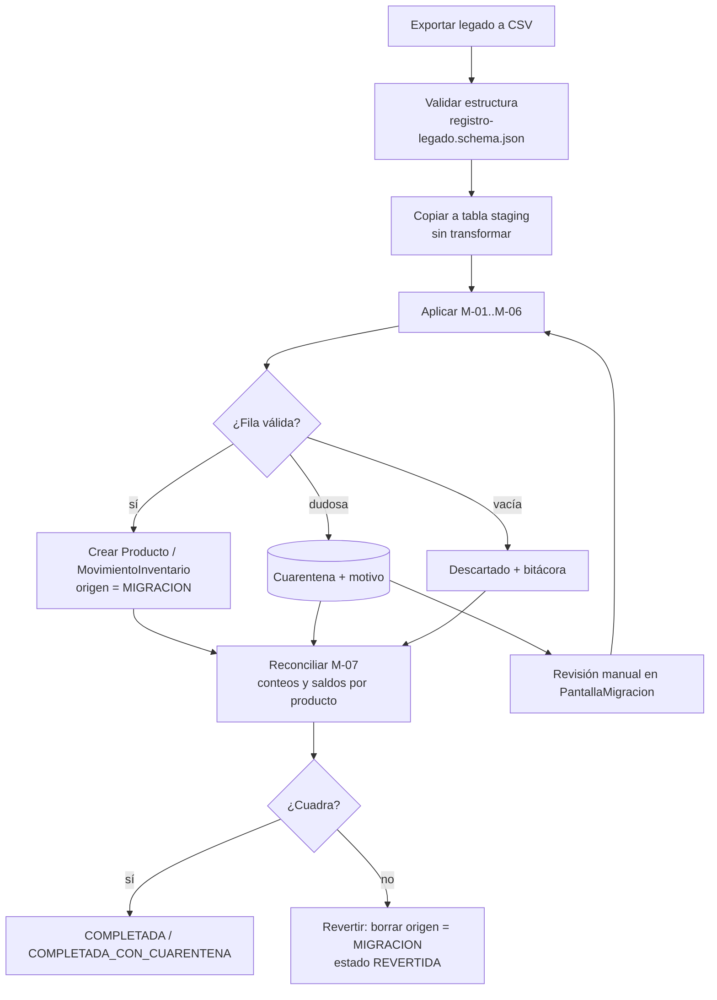

# 06 · Migración del sistema legado

## 1. Objetivo
Llevar todo el histórico del almacén (`fecha, ingreso, salida, producto, nro_documento`) a las nuevas
entidades **sin perder trazabilidad**: cada fila legada debe poder encontrarse en el sistema nuevo,
o en la cuarentena con el motivo, a partir de su `id` original.

**Decisión clave:** el histórico **no se re-emite** como comprobante electrónico (esas ventas ya
ocurrieron con comprobantes físicos o informales). Se migra como **movimientos de inventario**
(Formato 12.1, RS 234-2006) cuyo `documentoSustento` conserva el número original. Los productos
legados se convierten en el maestro `Producto` y su saldo final es el **saldo inicial** del sistema nuevo.

## 2. Destinos
| Campo legado | Entidad / campo destino | Transformación |
|---|---|---|
| `id` | `MovimientoInventario.idLegado` y `ResultadoMigracion.trazas[].idLegado` | Copia literal (M-07) |
| `fecha` | `MovimientoInventario.fecha` | M-01 |
| `ingreso` | `MovimientoInventario` tipo `INGRESO` o `AJUSTE_*`, `cantidad` | M-02, M-05 |
| `salida` | `MovimientoInventario` tipo `SALIDA` o `AJUSTE_*`, `cantidad` | M-02, M-05 |
| `producto` | `Producto` (`descripcion`, `codigo`, `idLegado`) y `MovimientoInventario.productoId` | M-03, M-06 |
| `nro_documento` | `MovimientoInventario.documentoSustento` (`tipo`, `numero`) | M-04 |

Detalle campo a campo: `mapeo-legado.csv`. Cruce con SUNAT/UBL: `specs/05-trazabilidad/matriz.csv` (T-48…T-52).

## 3. Reglas de migración
| ID | Regla | Si no se cumple |
|---|---|---|
| **M-01** Fecha | Aceptar `AAAA-MM-DD` y `DD/MM/AAAA`; convertir a ISO 8601. No futura. | Fecha vacía o inválida → CUARENTENA |
| **M-02** Cantidades | `ingreso` y `salida` numéricos ≥ 0. Si ambos > 0 → dos movimientos. Si ambos = 0 → DESCARTADO con bitácora. Decimales solo si la unidad lo permite (KGM, LTR). | Texto no numérico o decimal en NIU → CUARENTENA |
| **M-03** Producto | Normalizar: mayúsculas, sin tildes ni espacios dobles. Agrupar variantes iguales; generar `codigo` estable. Conservar el texto original en `idLegado`. | Similitud dudosa → CUARENTENA para unir manualmente |
| **M-04** Documento | Clasificar `nro_documento`: `^[FB]\d{3}-\d{1,8}$` → tipo 01/03 físico; `^GR-` → guía (09); `AJUSTE` → INTERNO; vacío o sin serie → INTERNO con marca `NO_IDENTIFICADO`; serie mal escrita (`b1-89`) → propuesta de reparación (`B001-89`) que requiere aprobación. Duplicados (mismo número en fechas distintas) → CUARENTENA. | Ver columna |
| **M-05** Ajustes | Cantidad negativa o documento `AJUSTE` → `AJUSTE_POSITIVO` / `AJUSTE_NEGATIVO` con valor absoluto. | — |
| **M-06** Configuración tributaria | Marcar productos que requieren decisión: bebidas alcohólicas/cigarrillos → ISC pendiente (cat. 08, D-05); bolsas plásticas → `esBolsaPlastica = true` (ICBPER). Todos inician con afectación `10` salvo indicación (D-04). | El producto se crea inactivo hasta completar su configuración |
| **M-07** Trazabilidad | Toda fila termina en exactamente un estado: MIGRADO, CUARENTENA o DESCARTADO, con las reglas aplicadas. `leidos = migrados + cuarentena + descartados`. | La migración falla y se revierte |

## 4. Proceso

1. **Simulación primero:** `POST /migraciones?simulacion=true` ejecuta todo sin escribir y devuelve el
   `ResultadoMigracion` para revisión. Solo después se ejecuta con `simulacion=false`.
2. **Reversible:** todo lo creado lleva `origen = MIGRACION` y el id de la ejecución;
   `POST /migraciones/{id}/revertir` lo elimina sin tocar datos creados por el sistema.
3. **Reconciliación:** para cada producto, `Σ ingresos − Σ salidas` del legado = saldo migrado.
   Una diferencia distinta de cero (excluyendo cuarentena) detiene la migración.
4. **El legado no se modifica.** Se trabaja sobre una copia exportada.

## 5. Resultado esperado con la muestra (`docs/legado/legado-almacen-muestra.csv`)
| id | Resultado | Reglas |
|---|---|---|
| 1, 2, 4, 8, 9 | MIGRADO | M-01, M-02, M-03, M-04 (8: M-06 ISC; 9: M-06 ICBPER) |
| 3 | MIGRADO (fecha convertida) | M-01 |
| 5 | MIGRADO con documento INTERNO `NO_IDENTIFICADO` | M-03, M-04 |
| 6 | MIGRADO con documento INTERNO `NO_IDENTIFICADO` | M-04 |
| 7 | CUARENTENA (reparación `B001-89` propuesta) | M-04 |
| 10 | MIGRADO como `AJUSTE_NEGATIVO` 2 | M-05 |
| 11 | DESCARTADO (sin movimiento) | M-02 |
| 12 | MIGRADO como dos movimientos | M-02 |
| 13 | CUARENTENA (sin fecha) | M-01 |
| 14 | CUARENTENA (decimal en NIU) | M-02 |
| 15 | CUARENTENA (documento duplicado de id 3) | M-04 |

Totales esperados: **leídos 15 = migrados 10 + cuarentena 4 + descartados 1** (M-07).
`tools/verificar.py` comprueba que esta tabla cubra cada `id` de la muestra exactamente una vez.
