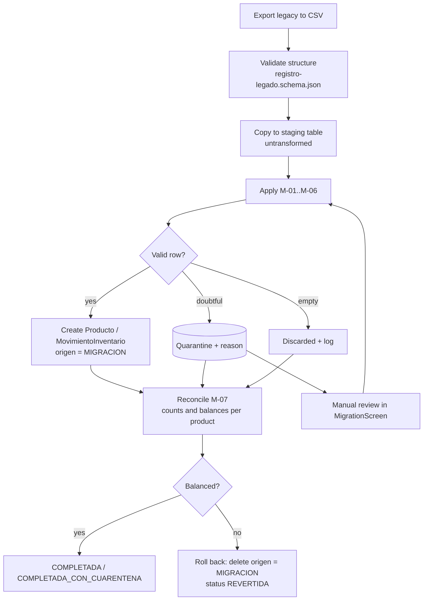

# 06 · Legacy system migration

## 1. Goal
Move the whole warehouse history (`fecha, ingreso, salida, producto, nro_documento`) into the new
entities **without losing traceability**: every legacy row must be findable in the new system, or in
quarantine with its reason, from its original `id`.

**Key decision:** history is **not re-issued** as electronic documents (those sales already happened with
paper or informal documents). It is migrated as **inventory movements** (Format 12.1, RS 234-2006) whose
`documentoSustento` keeps the original number. Legacy products become the `Producto` master and their
final balance is the **opening balance** of the new system.

## 2. Targets
| Legacy field | Target entity / field | Transformation |
|---|---|---|
| `id` | `MovimientoInventario.idLegado` and `ResultadoMigracion.trazas[].idLegado` | Literal copy (M-07) |
| `fecha` | `MovimientoInventario.fecha` | M-01 |
| `ingreso` | `MovimientoInventario` type `INGRESO` or `AJUSTE_*`, `cantidad` | M-02, M-05 |
| `salida` | `MovimientoInventario` type `SALIDA` or `AJUSTE_*`, `cantidad` | M-02, M-05 |
| `producto` | `Producto` (`descripcion`, `codigo`, `idLegado`) and `MovimientoInventario.productoId` | M-03, M-06 |
| `nro_documento` | `MovimientoInventario.documentoSustento` (`tipo`, `numero`) | M-04 |

Field-by-field detail: `mapeo-legado.csv`. Cross-check with SUNAT/UBL: `specs/05-trazabilidad/matriz.csv` (T-48…T-52).

## 3. Migration rules
| ID | Rule | If not met |
|---|---|---|
| **M-01** Date | Accept `YYYY-MM-DD` and `DD/MM/YYYY`; convert to ISO 8601. Not in the future. | Empty or invalid date → QUARANTINE |
| **M-02** Quantities | `ingreso` and `salida` numeric ≥ 0. If both > 0 → two movements. If both = 0 → DISCARDED and logged. Decimals only if the unit allows them (KGM, LTR). | Non-numeric text or decimal in NIU → QUARANTINE |
| **M-03** Product | Normalize: uppercase, no accents, single spaces. Group equal variants; generate a stable `codigo`. Keep the original text in `idLegado`. | Doubtful similarity → QUARANTINE for manual merge |
| **M-04** Document | Classify `nro_documento`: `^[FB]\d{3}-\d{1,8}$` → paper type 01/03; `^GR-` → dispatch guide (09); `AJUSTE` → INTERNAL; empty or without series → INTERNAL flagged `NO_IDENTIFICADO`; mistyped series (`b1-89`) → proposed repair (`B001-89`) requiring approval. Duplicates (same number on different dates) → QUARANTINE. | See column |
| **M-05** Adjustments | Negative quantity or document `AJUSTE` → `AJUSTE_POSITIVO` / `AJUSTE_NEGATIVO` with absolute value. | — |
| **M-06** Tax configuration | Flag products that need a decision: alcoholic drinks/cigarettes → pending ISC (cat. 08, D-05); plastic bags → `esBolsaPlastica = true` (ICBPER). All start with treatment `10` unless stated (D-04). | Product created inactive until configured |
| **M-07** Traceability | Every row ends in exactly one state: MIGRATED, QUARANTINE or DISCARDED, with the rules applied. `read = migrated + quarantined + discarded`. | The migration fails and is rolled back |

## 4. Process

1. **Dry run first:** `POST /migraciones?simulacion=true` runs everything without writing and returns the
   `ResultadoMigracion` for review. Only then is it run with `simulacion=false`.
2. **Reversible:** everything created carries `origen = MIGRACION` and the run id;
   `POST /migraciones/{id}/revertir` deletes it without touching data created by the system.
3. **Reconciliation:** per product, `Σ inputs − Σ outputs` in the legacy = migrated balance.
   Any non-zero difference (excluding quarantine) stops the migration.
4. **The legacy system is never modified.** Work is done on an exported copy.

## 5. Expected result with the sample (`docs/legado/legado-almacen-muestra.csv`)
| id | Result | Rules |
|---|---|---|
| 1, 2, 4, 8, 9 | MIGRATED | M-01, M-02, M-03, M-04 (8: M-06 ISC; 9: M-06 ICBPER) |
| 3 | MIGRATED (date converted) | M-01 |
| 5 | MIGRATED with INTERNAL document `NO_IDENTIFICADO` | M-03, M-04 |
| 6 | MIGRATED with INTERNAL document `NO_IDENTIFICADO` | M-04 |
| 7 | QUARANTINE (repair `B001-89` proposed) | M-04 |
| 10 | MIGRATED as `AJUSTE_NEGATIVO` 2 | M-05 |
| 11 | DISCARDED (no movement) | M-02 |
| 12 | MIGRATED as two movements | M-02 |
| 13 | QUARANTINE (no date) | M-01 |
| 14 | QUARANTINE (decimal in NIU) | M-02 |
| 15 | QUARANTINE (duplicate document of id 3) | M-04 |

Expected totals: **read 15 = migrated 10 + quarantined 4 + discarded 1** (M-07).
`tools/verificar.py` checks that this table covers every sample `id` exactly once.
